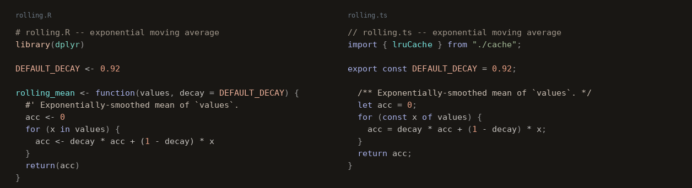
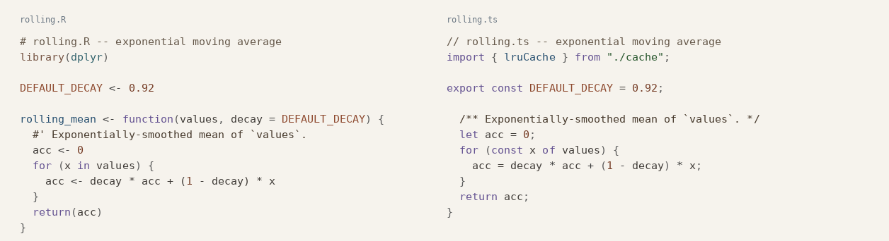
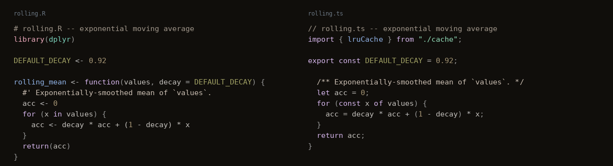

# Grotto

Warm VS Code themes in two variants: Grotto Night on a brown-black background and Grotto Day on an off-white one.





In both, body text has a 10:1 contrast ratio against the background. Code stays at 4.5:1 or above on the background and on every highlight, and placeholder text and line numbers stay at 3:1 or above. Selection, search matches, and added, removed, and changed lines each get a distinct tint. Errors are red, warnings are yellow, and success is green.

Grotto Night is built for color vision deficiency. Every color pair that must stay apart is checked under simulated protanopia, deuteranopia, and tritanopia. Most pairs stay apart by color alone. Where color can't do it, as with added and removed diff lines, VS Code also marks the difference without color, using the `+` and `-` gutter signs or the error underline.

## Install

From the repository root, copy the extension into your VS Code extensions folder:

```bash
cp -r out/soft-night-v2/vscode-preview ~/.vscode/extensions/grotto-soft-objective-v2
```

For Grotto Day, also copy its extension:

```bash
cp -r out/soft-day-v2/vscode-preview ~/.vscode/extensions/grotto-soft-objective-v2-day
```

Restart VS Code, run **Preferences: Color Theme**, and choose **Grotto S2-Explore 01 Night** or **Grotto S2-Explore 01 Day**.

To try the theme without installing it:

```bash
code --extensionDevelopmentPath="$PWD/out/soft-night-v2/vscode-preview"
```

## Experimental: Grotto Night CVD



A variant for color vision deficiency. VS Code still draws the gutter signs and underlines, but this variant doesn't count on them. It tries to keep colors apart by color alone. It has a darker background and more lightness difference between colors that must not be confused. It keeps 68 of 78 must-differ color pairs apart under simulated protanopia, deuteranopia, and tritanopia, against 63 for Grotto Night. The same contrast floors apply.

Install it the same way. It sits next to Grotto Night instead of replacing it:

```bash
cp -r out/soft-night-v2-cvd/vscode-preview ~/.vscode/extensions/grotto-soft-objective-v2-cvd
```

Then choose **Grotto S2-CVD 01 Night**.

All three themes are previews. If something is hard to read, [open an issue](https://github.com/sims1253/grotto/issues) with the theme, the language, the font, and a code sample.

[MIT license](LICENSE).
