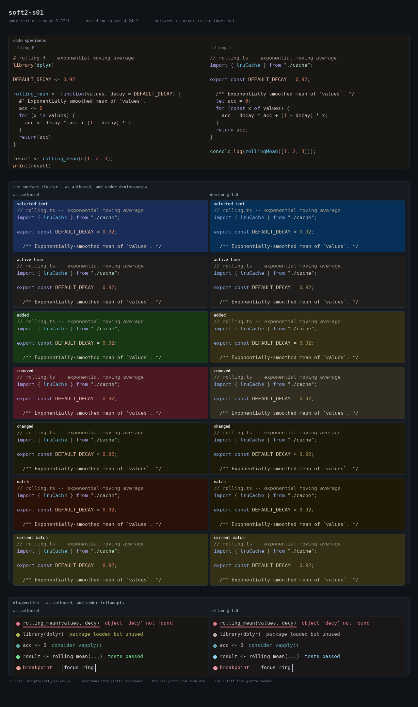

# The soft objective, v2: the palette was boxed in by its muted text

Companion to [soft-objective.md](soft-objective.md) (v1, PR #3) and
[redundant-channel-audit.md](redundant-channel-audit.md). v1 ended
"converged inside the declared design" and left the design decisions to the
owner. This round takes those decisions, one at a time, each looked at in a
rendered sheet as well as scored. Runs 7–12 were measured on the **unchanged
v1 instrument**. Run 13 then fixes two blind spots in the instrument itself
(§6), and the shipped palette is re-searched on it.

**Result.** `out/soft-night-v2/soft2-s01.night.yaml` scores **0.9853** on
instrument v2, against **0.9561** for #3's soft-s01 and **0.8644** for the
committed candidate-b. Zero WCAG violations, zero salience reversals, zero
prominence reversals. On the v1 instrument, the run-12 palette scored 0.9797
against v1's 0.9392. It got there under a gate that is **stricter** than v1's,
which v1's own shipped palette now fails (washed-out `error`, see §2).

| palette (instrument v2) | utility | SEP | EMPH | worst J | at target |
|---|---|---|---|---|---|
| candidate-b balanced night (committed) | 0.8644 | 0.1356 | 0.0199 | 0.000 | 79/127 |
| middle-m01 | 0.9513 | 0.0440 | 0.0456 | 0.282 | 98 |
| soft-s01 (v1, PR #3) | 0.9561 | 0.0439 | 0.0426 | 0.215 | 94 |
| **soft2-s01 (this PR)** | **0.9853** | **0.0147** | 0.0429 | 0.174 | **110** |
| soft2-cvd-s01 (experimental, §7) | 0.9843 | 0.0157 | 0.0407 | 0.340 | 110 |
| numeric-n01 (rejected) | 0.6554 | 0.0279 | 0.0857 | 0.507 | 108 |

Emphasis stays under the 0.045 budget. The tripwire still holds: numeric-n01
ranks last.



---

## 1. The binding constraint was never the fence (run 7, +0.031)

v1 and the audit both concluded the surface cluster needed a wider lightness
fence (audit §8: "the fence is 1.6–2.9× too tight"). Widening it alone
**did nothing** (0.9322, and inadmissible). The surfaces did not move.

The reason is one rule upstream of the fence: every highlight surface must keep
every floored scaffold ink legible on it. `fg_muted` and `line_number` (and the
border `ui_inactive`) sit on the 3:1 non-text floor at L 0.528:

| scaffold ink | floor | highest surface L it allows |
|---|---|---|
| fg_muted, line_number, ui_inactive | 3.0 | **0.250** |
| comment, punctuation, fg_secondary, deprecated | 4.5 | 0.312 |
| fg, docstring, operator, … | 4.5 | 0.430 |

With surfaces held at the canvas +0.01 (0.215), **all seven co-occurring
surfaces shared a 0.035 band of lightness.** The §8 seating that called the
cluster "feasible with 0.68 of the axis to spare" did not model this, which is
why it put surfaces at L 0.13–0.45.

**Decision:** lift the three to L 0.585. Muted text goes from 3.37:1 to
4.24:1 on the canvas, which `spec/roles.yaml` explicitly sanctions ("Floor is
set by accessibility, not aesthetics… even though it looks 'too visible'"). It
stays 0.09 below comments, so the hierarchy holds. The surface ceiling moves to
0.31, set by the 4.5:1 body-text inks, which are deliberately not touched.

Together with that, the fence widens **only for roles whose spec declares
`lightness_offset`** (selection, search_match_current, the diff washes, error,
success, focus). That is ±0.12 for surfaces, and −0.08 for inks, downward only,
because an early probe parked `error` at L 0.96, C 0.012, i.e. white. Every
other role keeps the middle fence.

## 2. Things the number cannot see, found by looking (runs 8, 9, 12)

Each of these raised or held utility while making the theme worse. Each is now
a hard constraint in the search **and** in `scripts/soft_gate.py`.

| defect, as rendered | fix |
|---|---|
| `diff_added` at h 95: an olive/khaki "added" | soft hue window [120,160] (`success` too, its same_family pair); `diff_removed` [10,40] (not crimson-magenta) |
| `search_match_current` at L 0.215, C 0.020: **the dimmest surface on screen**, beside a brighter ordinary match. Normalised chroma flatters a wash parked at the canvas, so the salience gate passed it. | **surface prominence rank**: inside a hue family, a higher-salience surface stands at least as far off the canvas (OKLab ΔE) as a lower-salience one |
| `error` at L 0.92, C 0.02: pale pink, read as body text. `warning` at L 0.92, C 0.034: peach. `breakpoint`: a white dot | role chroma floors (error/warning 0.065, breakpoint 0.05) at L ≤ 0.83/0.86/0.86, where the 70% gamut ceiling can hold them |
| unconstrained roles placed below the 0.02 chroma floor | placement output is re-projected through the fences |

The diagnostics only showed up because `scripts/soft_preview.py` now draws
them: a strip with the `4px double` underline VS Code actually uses, with
gutter marks, shown as authored and under **tritanopia** (the CVD that
collapses error/warning). The preview also had a defect of its own. It drew
the code specimens on a fixed cool `#161b22` card rather than the palette's
warm canvas, so every syntax colour was being judged against a background the
theme never draws. It now uses `bg`. The cluster shows all seven surfaces.

The `error` floor is the one constraint that cost utility: **−0.0062**. That
is the price of an error that looks like an error, and it is paid.

## 3. The search (runs 8, 10)

* **Salience-aware ascent.** The objective cannot see salience, so the ascent
  walked into states the post-repair could not leave (`error` 0.19 below
  `breakpoint` in normalised chroma). Moves are now accepted
  lexicographically: fewer salience/prominence reversals for the moved role
  first, then utility. The guard uses a closed-form OKLab→sRGB gamut test,
  because `grotto.color.max_chroma` costs ~1 ms per call. It agrees with the
  exact definition to < 0.002, and `finalize` and the gate still use the exact
  one.
* **The salience repair tries both orders.** It always raised the
  higher-salience role first, which meant boosting `error` (9 objective terms)
  past `breakpoint` (0 terms, free to quiet). That cost ~0.02 on every seed.
  Both orders now run on copies, and the better final utility wins. The
  benchmark went **0.9718 → 0.9845** and the seed spread **0.0167 → 0.0025**.
  This also fixed a latent bug: the "lower" pass left a rejected step applied.

## 4. Benchmark record

`.auto/log.jsonl`, runs 7–13 (fixed budget, three seeds, `.auto/measure.sh`):

| run | change | utility | spread | verdict |
|---|---|---|---|---|
| 6 (v1) | — | 0.9369 | 0.0021 | baseline |
| 7 | lift muted inks; lightness_offset fences | 0.9676 | 0.0050 | keep |
| 8 | convention windows, prominence rank, salience-aware ascent | 0.9782 | 0.0190 | keep |
| 9 | success in the green window | 0.9718 | 0.0167 | keep (constraint; drop inside spread) |
| 10 | salience repair tries both orders | 0.9845 | 0.0025 | keep |
| 11 | post-process 5 candidates, not 3 | 0.9845 | 0.0025 | discard (identical) |
| 12 | diagnostic chroma floors + preview | 0.9783 | 0.0029 | keep (constraint) |
| 13* | **instrument v2** (§6), search optimises its table | 0.9827 | 0.0003 | keep — *not comparable with ≤ 12* |
| 14 | inks get 0.10 more downward room | 0.9848 | 0.0003 | discard: `function` faded to C 0.03, plain text |
| 15 | same, plus a 0.05 chroma floor for syntax inks | 0.9844 | 0.0012 | keep |

**Benchmark change, declared:** the per-seed cap is now **process CPU time**
(still 16 s), not wall clock. This VM is a shared 2-core machine. Under
another job's load, the *unchanged* run-7 search measured 17.5 s wall, so the
wall cap was measuring the neighbours. The iteration budget is unchanged.

`soft_gate.py` now reads the fence table from `soft_palette.SoftProblem`
(never a score), so the gate and the search cannot disagree about where the
fences are.

## 5. What is left, and whose call it is

Remaining SEP on the shipped palette is 0.0147 (instrument v2). It splits
three ways.

* **42%: two scaffold-only should-pairs** no search can move, `bg`/`bg_elevated`
  (dE 0.033 vs 0.08) and `bg_elevated`/`bg_overlay` (0.027). Closing them
  means much larger elevation steps for panels. That is the open DESIGN
  question Q-2 (direction and size of elevation), and **is the owner's**.
* **43%: visibility overshoot**: the diff washes (margin 0.47, so about 2× past
  `minimal`), selection (0.60) and `search_match` (0.72). This is the matrix
  contradiction in §6, also the owner's.
* **15%: must pairs**, below.

The rest is spread thin: `error` against `builtin` and `fg` under normal vision
(error's red is held to L ≤ 0.83 by its chroma floor, close to the rose-family
`builtin`), `active_line` against the diff washes, and the three pairs the
channel audit found **uncovered**: error/warning (tritan),
search_match/current and selection/active_line. Those three still need a
genuinely distinct mark in the mapping, as the audit says. No palette
setting supplies one.

Earlier in this round, `diff_changed` and `search_match` shipped as two
nearly identical browns. Instrument v2's surface anti-collapse and visibility
terms now separate them (olive vs rust). If a search inside a modified hunk
matters, the matrix should also make it a `must_distinguish` pair.

Not done, deliberately:

* `active_line` stays pinned scaffold (run 4's "free it" lever is still the
  owner's decision).
* No `src/grotto` or `spec/` change. Everything is a declared trial setting in
  `scripts/soft_palette.py`.
* v1's artifacts in `out/soft-night/` are untouched. Several tests and the
  channel audit pin numbers to them, and they are the comparison point.

## 6. Instrument v2: what the scoring script could not see (run 13)

Everything above was measured on v1's `soft_metric.py`, unchanged. Looking at
the sheets turned up two blind spots in the instrument itself, and both are
now fixed in `scripts/soft_metric.py` (`INSTRUMENT_VERSION = 2`). The search
optimises exactly the instrument's term table, and a test asserts they agree
to 1e-12.

**a. No surface was ever compared to the canvas.** The matrix pairs surfaces
with each other, never with `bg`, so a wash could vanish into the background
or shout off it at no cost. v2 (run 12) did both. `search_match` (target
`low`) sat at ΔE 0.030, identical to `diff_changed`. Meanwhile selection and
the diff washes stood 2–4× further off the canvas than their class allows.
That is the O4-vs-O2 trade (CVD separation bought with lightness), which
DESIGN.md resolves *against*.

The spec already says how far a surface should stand off the canvas:
`model.SURFACE_STEPS`, keyed by the role's `contrast_target` (minimal 0.030,
low 0.055, comfortable 0.080, …). The new **visibility** term reads a band
from a class's step to the next class's, with margin `min(ΔE/lo, hi/ΔE)`. It
uses the same bounded shortfall as every other term. Validation: the committed
candidate-b night, which is that transform's output, is in-band on all eight
surfaces (0.99–1.12). Alongside it, the matrix's own "still not identical"
anti-collapse floor (0.03) now also covers co-occurring surface pairs the
matrix leaves unconstrained, not only categorical inks.

**b. CVD terms the spec says are already discharged.** The matrix's CVD floor
reads "pairs that cannot meet this must carry a redundant channel": the floor
*or* a channel. `grotto.channels.judge` (#3's audit) answers that per pair,
against what VS Code actually draws. v2 credits only those pairs, and only
their CVD terms (53 of them, e.g. diff added/removed via the `+`/`−` gutter
sign). Normal-vision terms always stay, and so does every term of the three
pairs the audit found uncovered (error/warning, search_match/current,
selection/active_line).

Rescored on instrument v2 (127 terms; **not comparable** with v1 numbers):

| palette | v1 utility | v2 utility |
|---|---|---|
| candidate-a restrained | 0.7900 | 0.8006 |
| candidate-b balanced (committed) | 0.7896 | 0.8644 |
| candidate-c expressive | 0.8022 | 0.8763 |
| middle-m01 | 0.9361 | 0.9513 |
| soft-s01 (#3) | 0.9392 | 0.9561 |
| soft2-s01 as shipped after run 12 | 0.9797 | 0.9746 |
| soft2-s01 re-searched on v2 (run 13) | — | 0.9828 |
| **soft2-s01 as shipped (run 15, §7)** | — | **0.9853** |
| numeric-n01 (rejected) | 0.6605 | 0.6554 |

The tripwire holds: numeric-n01 is still last. Re-searching on v2 separates
"changed" from "match" (olive and rust instead of two identical browns) and
pulls `search_match` up to its `low` step.

**What v2 makes visible rather than solves.** The diff washes still settle
about 2× past the `minimal` band. That is not a search failure. The matrix asks
two washes to be 0.13 apart under normal vision, and two washes that each stand
≤ 0.055 off the canvas cannot be. `distance-matrix.yaml`'s 0.13 (a
text-recognition threshold) and `SURFACE_STEPS`' `minimal` contradict each
other for large adjacent fields, and the score now shows the compromise instead
of hiding it. Which one gives is the owner's call: a lower must threshold for
surface/surface pairs, or a `low` target for the diff washes.

## 7. Experimental: a CVD variant, and which fences only cost (run 15, cvd runs 1–10)

`--profile cvd` (`soft_palette.PROFILES`) scores CVD on **colour alone**, with no
credit for the gutter signs and underlines, and relaxes fences that do not
protect normal-vision legibility. The WCAG floors, the convention windows, the
salience and prominence ranks and the diagnostic chroma floors are identical in
both profiles. `.auto/measure.sh` takes `AR_PROFILE=cvd`, and `soft_metric.py
--colour-only` scores it.

| cvd run | change | colour-only utility | CVD pass /78 | verdict |
|---|---|---|---|---|
| 1 | objective only | 0.9764 | 52.0 | baseline: the fences bind, not the objective |
| 2 | inks 0.10 more downward room (floor L 0.66) | 0.9820 | 62.3 | keep |
| 3 | 0.16 room, floor 0.60 | 0.9787 | 57.7 | discard: the local search does worse in a bigger space |
| 4 | syntax chroma cap 0.12 → 0.16 | 0.9818 | 63.0 | discard: the cap does not bind (max C 0.124) |
| 5 | lift comments to L 0.72, muted inks to 0.62 | 0.9834 | 63.3 | kept, then ablated in run 8 |
| 6 | visibility bands one class louder | — | 62.0 | discard: the band does not hold the washes |
| 7 | **darker canvas** 0.205 → 0.165 | 0.9824 | **66.7** | keep |
| 8 | undo run 5 | 0.9835 | 66.0 | keep: same result, comments unchanged |
| 10 | surfaces 0.06 more room, held at canvas + 0.01 | 0.9853 | 64.7 | keep |

The finding behind run 7 is geometry. The added and removed washes need about
0.09 of lightness between them, and between each of them and the active line,
once dichromacy removes their hue. With the canvas at 0.205 the washes had
0.215–0.355 to share. That is too little room at any fence setting, and the
ceiling comes from comments needing 4.5:1 on every highlight. A darker canvas
is the only lever that adds room at the bottom.

Two traps, both found in renders or by the gate:

* Without a canvas floor in the fence, cvd run 10 reached 70/78 by sinking
  `selection` to L 0.085 under a 0.165 canvas. That is a near-black hole too
  dark to carry its hue, and the gate rejected it. Surfaces now stay at
  canvas + 0.01 in both profiles.
* Run 14 brought the ink relaxation to Grotto Night: 0.9827 → 0.9848. The
  ascent spent the room muting `function` to C 0.03, so `rolling_mean` read as
  plain near-white text. Run 15 adds `SYNTAX_CHROMA_FLOOR = 0.05` for
  categorical inks and keeps the relaxation. Fences that only cost are now
  gone from Grotto Night too: 54 → 63 of 78 CVD checks pass on colour alone,
  as a side effect.

Shipped, both at full budget and both admitted by the gate:

| | utility (v2) | colour-only utility | CVD pass /78 | canvas |
|---|---|---|---|---|
| Grotto Night `out/soft-night-v2/soft2-s01` | 0.9853 | 0.9758 | 63 | L 0.205 |
| Grotto Night CVD `out/soft-night-v2-cvd/soft2-cvd-s01` | 0.9843 | 0.9858 | **68** | L 0.165 |

The CVD variant installs next to Grotto Night (`grotto-soft-objective-v2-cvd`).
The 10 checks it still misses are almost all surfaces against `active_line`
and `selection` under tritan and protan. Holding the active line at canvas +
0.03 ("a very small lightness step", `spec/roles.yaml`) is what leaves them.

## 8. Reproducing

```bash
uv run python scripts/soft_palette.py --restarts 24 --samples 16 \
    --refine-passes 30 --select 6 --no-install          # -> out/soft-night-v2
uv run python scripts/soft_gate.py out/soft-night-v2
uv run python scripts/soft_palette.py --profile cvd --restarts 24 --samples 16 \
    --refine-passes 30 --select 6 --no-install          # -> out/soft-night-v2-cvd
uv run python scripts/soft_metric.py --colour-only out/soft-night-v2/soft2-s01.night.yaml \
    out/soft-night-v2-cvd/soft2-cvd-s01.night.yaml
uv run python scripts/soft_metric.py out/soft-night/soft-s01.night.yaml \
    out/soft-night-v2/soft2-s01.night.yaml
uv run python scripts/soft_preview.py out/soft-night-v2 \
    out/soft-night-v2/soft2-s01.night.yaml out/soft-night/soft-s01.night.yaml \
    themes/candidates/candidate-b-balanced.night.yaml
uv run pytest tests/test_soft_v2.py -q
```

**NON-CANDIDATE.** Promotion is the owner's call. Install
`out/soft-night-v2/vscode-preview/` to look at it in a real editor. Nothing
here substitutes for that.
